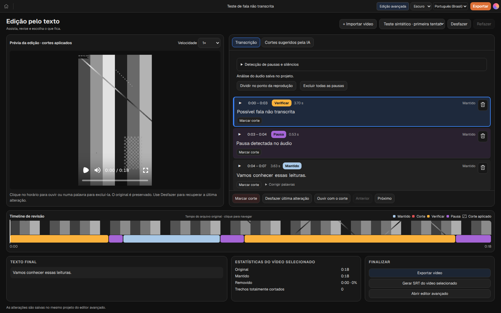
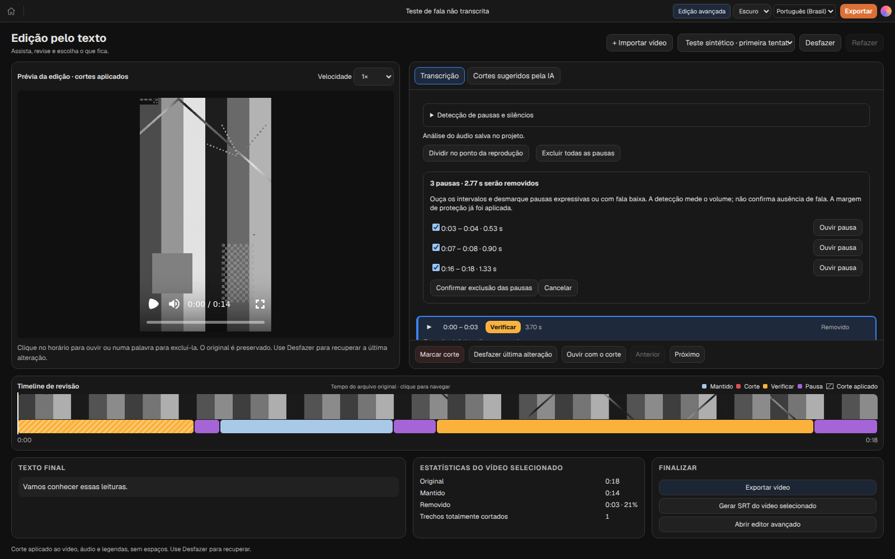

# Segmentação por áudio — CurtaCut 0.2.27

## Uso

1. Abra um vídeo local no editor simplificado. A análise automática de pausas usa FFmpeg, sem iniciar Whisper. A transcrição permanece uma ação separada.
2. Transcreva com o modelo desejado, inclusive Tiny. As palavras reconhecidas se combinam com as regiões acústicas. Regiões sem texto aparecem como **Possível fala não transcrita**, sem inventar palavras. Sons e ruídos também podem receber essa indicação.
3. Use o horário ou botão de reprodução para ouvir; a lixeira corta o intervalo de vídeo, áudio e legendas e fecha os espaços. Desfazer/refazer recupera a operação conjunta durante a sessão.
4. **Excluir todas as pausas** abre uma lista para ouvir e selecionar intervalos; a quantidade e o tempo efetivamente removido respeitam os cortes anteriores. Confirme apenas os intervalos desejados.
5. **Dividir no ponto da reprodução** cria uma divisão de revisão entre palavras. Não altera o vídeo até um corte ser aplicado. As divisões ficam salvas no projeto.

## Configurações

**Detecção de pausas e silêncios** aparece no editor simplificado e em Configurações → Modelos locais → Transcrição local.

- Detecção automática: ligada por padrão no editor simplificado.
- Duração mínima: 500 ms (ajustável de 200 a 10000 ms).
- Sensibilidade: −35 dB (ajustável de −80 a −10 dB).
- Proteção: 150 ms em cada lado (ajustável de 0 a 1000 ms).
- Exibição dos blocos de pausa: ligada por padrão.

Mudar o limite de volume ou a duração mínima reanalisa o áudio, sem nova transcrição. A margem é aplicada sobre o resultado salvo. Cancelar encerra o processo FFmpeg. Falhas mostram uma mensagem e permitem tentar novamente; a edição por transcrição permanece disponível.

## Persistência e edição

A análise usa timestamps do arquivo, parâmetros e identidade da mídia; fica no projeto junto com as divisões manuais. Mudar de aba ou reabrir reaproveita o resultado. A análise automática aguarda a aquisição do acesso de escrita do editor antes de modificar o projeto. A execução lê a mídia importada e nunca escreve no original.

Os blocos são projetados sobre os clipes existentes. Cortes comuns já feitos continuam válidos. Velocidade alterada, transições, usos repetidos ou reordenados da mesma fonte e vínculos complexos continuam exigindo o editor avançado. A implementação não tenta desfazer montagens complexas para permitir cortes simplificados.

## Limites

- FFmpeg mede silêncio por amplitude, não reconhece fala. Palavras transcritas que contradizem um silêncio protegem aquele intervalo; sons sem palavras são indicados para revisão.
- Não há remoção automática de pausas nem novo uso do Silero VAD nesta versão. Exclusões em lote exigem revisão/confirmar; o recurso VAD existente do assistente permanece separado.
- O motor Whisper não muda; não foi adicionado CUDA. Esta melhoria não promete acelerar a inferência. Permite testar a edição com modelos menores sem depender só dos intervalos da transcrição.
- Fala contínua sem pausa acústica pode permanecer no mesmo bloco; use a divisão manual entre palavras. Uma palavra com timestamp incorreto ainda limita a precisão de seu corte individual.
- A restauração usa o histórico de desfazer/refazer da sessão, não uma reconstrução isolada de qualquer corte antigo.
- O vídeo real “Projeto sem título.mp4” citado pela usuária não estava disponível neste ambiente. A aceitação com essa gravação, fala baixa e pausas expressivas reais permanece pendente.

## Verificação

Testes do FFmpeg usam áudio controlado com duas regiões separadas, pausa final, áudio contínuo e ruído. Verificam tempos, progresso, cancelamento e falhas. Testes do modelo cobrem a primeira tentativa omitida no texto, proteção das palavras, pausas naturais, divisão manual, cortes reais em vídeo/áudio, SRT, histórico e persistência. O teste de navegador usa vídeo vertical sintético com AAC, revisa os blocos, alterna entre editores e reabre o projeto.

## Capturas da aplicação

As imagens usam vídeo e transcrição sintéticos, identificados como teste; não representam um reconhecimento real do Whisper.

