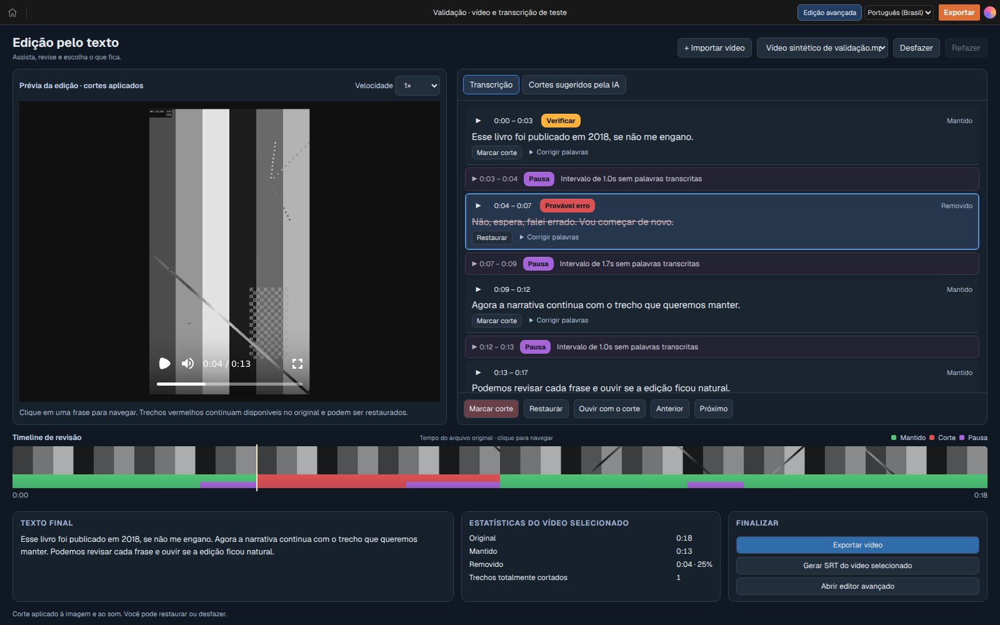
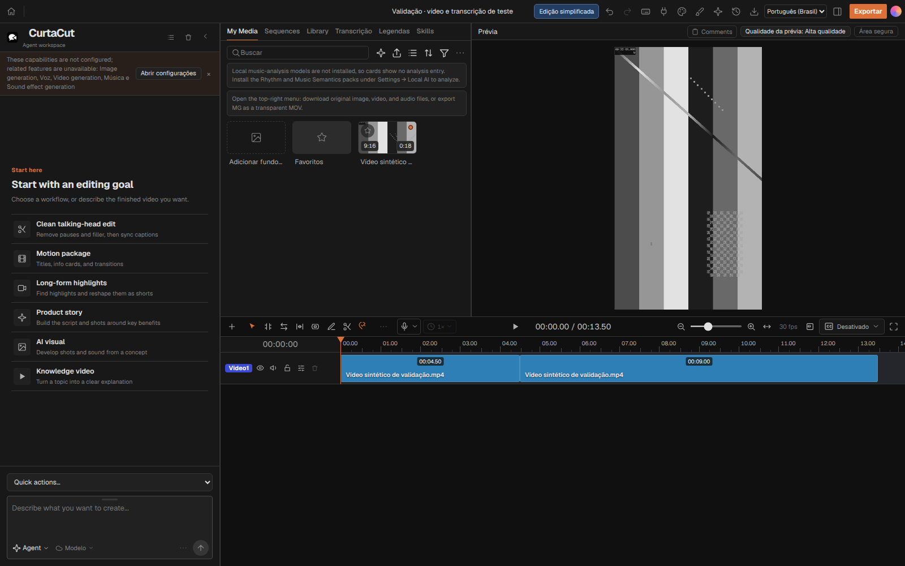

# Modo de Edição Simplificada — prévia 0.2.23

No computador, abra um projeto e use **Edição simplificada** na barra superior. Importe um vídeo e clique em **Transcrever** quando precisar gerar a transcrição. O modo usa as palavras e os tempos reais produzidos pelo provedor configurado, inclusive Whisper local.

## Revisão pelo texto

- Clique em uma frase para ir até a fala. O trecho em reprodução é destacado.
- **Marcar corte** divide e remove o intervalo da timeline real, com fechamento do espaço. O texto riscado continua visível para revisão.
- **Restaurar** reinsere os intervalos removidos do arquivo original. **Ouvir com o corte** toca a junção na edição atual.
- A correção de palavras altera o texto da transcrição, preservando tempos e áudio original. Não reescreve automaticamente uma faixa de legendas já criada.
- O player da edição reaproveita o renderizador existente. Para ouvir uma frase excluída, o modo abre a reprodução do arquivo original compatível.

## Projeto e exportação compartilhados

Os dois modos usam as mesmas ações, histórico, salvamento e mídia. Não existe uma lista paralela de cortes. A timeline compacta representa os tempos do **arquivo original**; o player da edição segue os tempos após os cortes. Verde indica conteúdo preservado, vermelho indica intervalos removidos e roxo indica lacunas entre palavras transcritas.

Texto final, estatísticas e SRT se referem ao vídeo selecionado. O SRT usa os tempos da timeline editada. **Exportar vídeo** abre o exportador existente, que exporta o projeto inteiro, incluindo outras faixas. A exportação preserva a mídia original.

## Limites desta prévia

Os selos aparecem ao lado dos horários, seguindo a paleta da referência: amarelo para **Verificar**, vermelho para **Provável erro**, roxo para **Pausa**. A seleção usa uma borda azul e fundo discreto; as mesmas cores identificam a timeline.

**Verificar** indica expressões de incerteza (como “se não me engano”) ou blocos inteiros de pelo menos cinco palavras repetidos. **Provável erro** indica expressões de retomada (como “falei errado” e “vou começar de novo”). São regras aplicadas ao texto real, não um parecer de IA. O motivo aparece ao passar o cursor no selo e também na aba de sugestões. A correção do texto recalcula os indícios. Falas literárias, citações e repetições intencionais podem receber indicação: sempre confira o contexto. Nenhum selo aplica um corte.

A análise contextual por IA ainda não está conectada. As pausas listadas são lacunas de pelo menos um segundo nos timestamps da transcrição, não uma confirmação de silêncio pelo áudio. Cada pausa aparece também na transcrição e pode ser ouvida.

Velocidade alterada, edição de áudio por palavras, repetição/reordenação do mesmo arquivo, múltiplas faixas do mesmo vídeo, faixas bloqueadas, transições, grupos vinculados e multicâmera exigem o editor avançado. O modo mostra a limitação antes de permitir alterações incompatíveis. O layout inicial é destinado a monitores desktop.

## Validação

- Testes do modelo executam os comandos reais e conferem cortes, restauração, histórico, reabertura e SRT.
- Um teste de navegador cria um vídeo vertical sintético com áudio AAC e uma transcrição de teste identificada. Verifica corte real, download SRT, junção, alternância, histórico compartilhado, salvamento e reabertura. Não simula um resultado do Whisper.
- Uma exportação real da fixture foi renderizada em retrato com áudio: de 18 segundos para aproximadamente 13,5 segundos após um corte de 4,5 segundos.
- As capturas abaixo são da aplicação em execução com essa fixture de validação. O padrão de vídeo é cinza para distinguir as cores da mídia das cores da interface.

